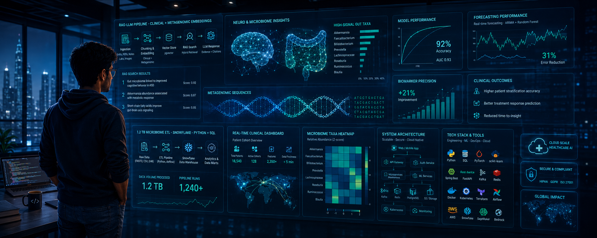

# Hi, I'm Brijesh Kumar 👋

### AI Software Engineer — RAG, multi-agent systems, and the evaluation that keeps them honest

**M.S. Computer Science @ Arizona State University · 4.0 / 4.0 · Graduating December 2026**

 

 

---

> [!IMPORTANT]
> **Open to full-time Applied AI / Software Engineering roles from December 2026.**
> Authorized to work in the U.S. on OPT · based in Tempe, AZ for my final semester, most weeks in San Francisco, happy to relocate.
> Right now I'm building agentic video search and evaluation harnesses at **EdPlus**, and grounded clinical RAG and forecasting pipelines at **ASU Biodesign**.

---

## 🎯 Hiring for something specific? Start here

| If you're hiring for… | Go straight to | What it proves |
|---|---|---|
| **AI / LLM engineering** | [SlackAgent](https://github.com/Brijesh03032001/SlackAgent) · [Aria](https://github.com/Brijesh03032001/Aria) · [TrustMed-AI](https://github.com/Brijesh03032001/TrustmedAi) | 59 tools through one MCP client at **97.2%** success · a 5-agent voice supervisor under **1 s** · grounded medical RAG with a **100-prompt** eval suite |
| **Backend / distributed systems** | [Nexus](https://github.com/Brijesh03032001/Nexus) · [QuarkCache](https://github.com/Brijesh03032001/quark-cache) | 4 Spring Boot services on Kafka with a **sub-50 ms** write path · a Redis-like C++17 store with epoll/kqueue, AOF and crash recovery |
| **Data / platform engineering** | [merger-lakehouse](https://github.com/Brijesh03032001/merger-lakehouse) · [eduMorph](https://github.com/Brijesh03032001/eduMorph) | **20M rows in 584 s** with entity resolution at **99.4%** precision · **1,000+ events/sec** through Azure into Synapse |
| **ML / data science** | [RetailForecastAI](https://github.com/Brijesh03032001/RetailForecastAI) · [churnopt](https://github.com/Brijesh03032001/churnopt) | **16.92% MAPE** beating four baselines · churn probabilities calibrated to **0.020 ECE** and turned into a profit-backed contact policy |
| **Full-stack product** | [FoodPilot AI](https://github.com/Brijesh03032001/foodai) · [StudySliceAI](https://github.com/Brijesh03032001/StudySliceAI) | Next.js + Spring Boot + FastAPI in one product · a 3-hour lecture cut to **6–7 minutes** on autoscaled AWS |
| **Cloud / DevOps / SRE** | [KubeGuard](https://github.com/Brijesh03032001/KubeGuard) · [StudySliceAI](https://github.com/Brijesh03032001/StudySliceAI) | Pod memory anomalies predicted **before** the limit breaks, feeding the HPA · 6 AWS resource groups in Terraform with CI/CD |

Every repo above has an architecture diagram, the engineering decisions behind it, and measured results — not just a stack list.

---

## 🧰 Tech stack

**Languages**

**AI, agents & retrieval**

`LangChain` · `LangGraph` · `Model Context Protocol` · `Multi-Agent Orchestration` · `Tool Calling` · `RAG` · `FAISS` · `ChromaDB` · `pgvector` · `mem0` · `AWS Bedrock` · `CLIP`

**Evaluation, reliability & safety**

`Evaluation Harnesses` · `Golden Sets` · `Grounding Checks` · `Guardrails` · `Human-in-the-Loop` · `PII Detection` · `Circuit Breakers` · `Dead-Letter Queues` · `Idempotency`

**Backend & data**

`Snowflake` · `Databricks` · `Delta Lake` · `PySpark` · `Apache Airflow` · `dbt` · `BigQuery`

**Frontend**

**Cloud & delivery**

---

## 💼 Experience

### EdPlus at Arizona State University — AI Software Engineer
`Sep 2025 – Present · Tempe, AZ`

- Shipped the customer-facing **React/Next.js** application used across 100+ recorded sessions, resolving natural-language queries to exact timestamps in **under 3 seconds** via a **pgvector** store over 10,000+ embeddings and three coordinated LangChain agents.
- Confirmed **89% agreement** with a manually labelled golden set of 300+ video chunks through an evaluation harness and a hard editor-confirmation guardrail, holding unauthorized AI deletions at **zero** in production.
- Cut infrastructure setup time **60%** by provisioning S3, IAM, ECS Fargate and Lambda through **Terraform** across 4 AWS resource groups, sustaining **99.5%+** uptime with CloudWatch alerting behind an autoscaling load balancer.

### ASU Biodesign Institute — Machine Learning Research Analyst
`Feb 2025 – Present · Tempe, AZ`

- Travelled on-site to **3 partner clinics** (60–80 patients each) to learn clinician workflows, then deployed a **RAG-LLM** document search product over ~2,000 indexed PDFs, validating retrieval with live users and training them directly.
- Cut unsupported clinical-answer claims **35%** against an ungrounded baseline across **560 clinician-labelled questions**, by having the LLM tool-call a **FAISS** retrieval function followed by a grounding check inside an evaluation loop.
- Built a Python + SQL + **Snowflake** ETL pipeline over a **1.2 TB** microbiome dataset with skew-aware partitioning, cutting LLM feature-prep time **65%** and surfacing **17 high-signal gut taxa**.

### AWL Metaverse Pvt. Ltd. — Software Engineer
`Mar 2024 – Dec 2024 · India`

- Sustained smooth playback for **5,000+ concurrent video sessions** with a React and TypeScript student player built on chunk-based streaming and adaptive buffering.
- Secured **FastAPI** microservices with **JWT/OAuth 2.0** and Pydantic validation (invalid requests down **80%**), and designed PostgreSQL schemas with compound indexes and JSONB fields, improving query performance **3×**.

### Quicket Solutions — Software Developer *(promoted from Intern)*
`Software Developer: Mar 2023 – Mar 2024 · Intern: Oct 2022 – Feb 2023 · India`

- Improved inter-service reliability to **99.6%** with **Redis** caching and circuit-breaker patterns adopted across three engineering teams, cutting database load **60%** during traffic spikes.
- Strengthened payment-data integrity through indexed PostgreSQL schema design, idempotency keys and **Stripe**-to-ledger reconciliation, eliminating duplicate charges on network-timeout retries. Awarded **Best Intern**.

---

## 🗂️ Projects

### 🤖 [SlackAgent](https://github.com/Brijesh03032001/SlackAgent) — Slack · GitHub · Notion AI agent
`TypeScript · Node.js · OpenAI GPT-4o · MCP · ChromaDB · mem0`
**12 custom Slack tools plus 47 GitHub and Notion tools** exposed through one MCP client, reaching **97.2% tool success** across 100+ concurrent test conversations, with RAG over 10,000+ indexed messages and long-term memory that survives a restart.

### 🌐 [Nexus](https://github.com/Brijesh03032001/Nexus) — Event-driven relationship CRM
`Java · Spring Boot · Kafka · RabbitMQ · Redis · AWS Bedrock · FAISS`
**4 Spring Boot services** with Kafka keeping AI enrichment off a **sub-50 ms** write path. Bedrock embeddings with FAISS lift contact matching **70%** over rules-only dedupe, and RabbitMQ workers retry follow-ups with dead-letter handling.

### 🎙️ [Aria](https://github.com/Brijesh03032001/Aria) — Voice-first agentic desktop assistant
`Electron · LangGraph · Deepgram · Cartesia · Claude`
Built for blind and visually impaired users: a LangGraph supervisor routes speech to **5 specialized agents** at **under 1 second** latency, and **3 high-risk action classes** pause for spoken confirmation with a **4-type PII scan** before anything is typed.

### 🏞️ [merger-lakehouse](https://github.com/Brijesh03032001/merger-lakehouse) — Post-acquisition Databricks lakehouse
`Databricks · Delta Lake · PySpark · Kafka · Auto Loader`
Bronze/Silver/Gold layers with change-aware MERGE loading **20M rows in 584 s**, SCD2 history, scoped backfills, and entity resolution at **99.4% precision / 92.4% recall** that resolves **91%** without a human.

### 👻 [Ghosty](https://github.com/Brijesh03032001/Ghosty_A_Conference_helper) — Conference follow-up assistant
`React Native · Expo · Deepgram · Claude · Supabase`
**🏆 Winner, Kiro Spark Challenge 2026** (ASU × AWS, 24-hour build). A 15-second voice memo becomes a scored contact card and a drafted follow-up, with an offline-first queue that recovered **100% of 30** simulated connectivity drops.

### 🌮 [FoodPilot AI](https://github.com/Brijesh03032001/foodai) — Agentic food-truck marketplace
`Next.js · Spring Boot · FastAPI · LangChain · LangGraph · Chroma`
A ReAct owner copilot answers "why did sales drop?" by calling a SQL sales tool and a vector review tool together, while a deterministic Order Builder checks every generated line against **2,622 seeded modifiers** before a human confirms.

<b>📦 Everything else — 13 more repositories</b>

 

| Project | What it is | Stack |
|---|---|---|
| [quark-cache](https://github.com/Brijesh03032001/quark-cache) | Redis-like KV store from scratch — O(1) LRU, epoll/kqueue, AOF with CRC32 and crash recovery | C++17 · FastAPI · Next.js |
| [KubeGuard](https://github.com/Brijesh03032001/KubeGuard) | AIOps agent predicting pod memory anomalies, feeding the HPA, asking Gemini for one kubectl fix | Kubernetes · LSTM · LightGBM · Go |
| [TrustMed-AI](https://github.com/Brijesh03032001/TrustmedAi) | Source-grounded medical RAG over 9K+ chunks with cross-encoder reranking and a 100-prompt eval suite | ChromaDB · FAISS · FastAPI |
| [RetailForecastAI](https://github.com/Brijesh03032001/RetailForecastAI) | Demand forecasting across 1,115 stores at 16.92% MAPE, with a RAG layer that explains each forecast | BigQuery ML · FastAPI · LangChain |
| [churnopt](https://github.com/Brijesh03032001/churnopt) | Churn prediction with dollar figures attached — leakage audit, calibration, profit-based contact policy | scikit-learn · DuckDB · Streamlit |
| [StyleNova-AI](https://github.com/Brijesh03032001/StyleNova-AI) | CLIP visual embeddings blended with a per-user preference vector learned from swipes | PyTorch · CLIP · FastAPI |
| [eduMorph](https://github.com/Brijesh03032001/eduMorph) | 1,000+ events/sec through Event Hubs into Synapse, with 3 governed metric definitions | Azure · Stream Analytics · Power BI |
| [veridiumMesh](https://github.com/Brijesh03032001/veridiumMesh) | AI-gated carbon credit issuance — risky credits blocked before mint, dual ECDSA, Merkle proofs | Solidity · Ethereum · scikit-learn |
| [StudySliceAI](https://github.com/Brijesh03032001/StudySliceAI) | 3-hour lecture → 6–7 minutes of study clips. 🥈 Runner-up, SunHacks 2025 | AWS · Terraform · Gemini · FFmpeg |
| [EmotiSphere](https://github.com/Brijesh03032001/EmotiSphere) | Speech-intent platform for stuttered and accented speech, with phoneme-accurate lip sync | React Three Fiber · Ollama · ElevenLabs |
| [EmotionClassifier](https://github.com/Brijesh03032001/EmotionClassifier) | Emotion-aware music retrieval — librosa DSP, clustering bake-off, pgvector search | librosa · Supabase · FastAPI |
| [SwiggyAnalysis](https://github.com/Brijesh03032001/SwiggyAnalysis) | 197,430 orders into a City Expansion Index and a Restaurant Health Score | Python · SciPy · Streamlit |
| [EnterpraNex](https://github.com/Brijesh03032001/EnterpraNex) | Enterprise workflow approval hub deployed to SAP BTP as an MTA | SAP CAP · UI5 · HANA Cloud |

---

## 🏆 Achievements

**Research & recognition**

|  |  |
|---|---|
| 📄 | **Sole-author Springer publication** — *Early Dementia Detection and Classification of Stage by Efficient Segmentation and Artificial Neural Network*, Smart Generation Computing and Communication Networks, 2026. **94%** accuracy on Alzheimer's-versus-Parkinson's FDG-PET classification — **[LINK](https://link.springer.com/chapter/10.1007/978-3-032-06798-2_8)** |
| 🎤 | Presented that paper at **Adv. Immunology 2026** in Amsterdam, October 21–22 |
| 🚀 | Accepted into **Y Combinator Startup School 2026** |
| 🌍 | Merged pull requests into **3 major open-source projects**, including Python repositories — **Open Source Super Contributor**, Hacktoberfest 2025 |

**Hackathons & competitions**

| Result | Event | Project |
|---|---|---|
| 🥇 Winner | Kiro Spark Challenge 2026 — ASU × AWS, 24-hour build | [Ghosty](https://github.com/Brijesh03032001/Ghosty_A_Conference_helper) |
| 🥇 Winner | CrozeAI Hackathon | — |
| 🥈 Runner-up | SunHacks 2025, Education Track | [StudySliceAI](https://github.com/Brijesh03032001/StudySliceAI) |
| 🥉 Top 3 | EmotiSphere Hackathon | [SpeakSmart AI](https://github.com/Brijesh03032001/EmotiSphere) |
| 🎯 Finalist | JPMorgan Code for Good 2024 | — |

**Competitive programming & certifications**

|  |  |
|---|---|
| 🥇 | **Top 0.2% in CodeKaze** — rank 315 of 150,000 participants |
| 🧩 | **1,000+ LeetCode problems** solved in C++ |
| ✅ | HackerRank — Problem Solving (Intermediate), Jul 2024 |
| 🎓 | Data Science Professional Certificate — IBM |
| 🧠 | Deep Learning Specialization — DeepLearning.AI |

---

## 📊 GitHub at a glance

---

## 🤝 Let's build something

I like problems where the hard part is making a system **trustworthy**, not just making it work once — where a wrong answer costs something, and someone has to be able to check it. That's why most of what I build ships with an evaluation harness, a guardrail, or a reconciliation step beside it.

If you're building something ambitious and want someone who can own the path from **data → models → backend → production**, I'd love to talk.

**[brijeshbuilds.com](https://brijeshbuilds.com) · [LinkedIn](https://linkedin.com/in/brijeshkumar03) · [kumarbrijesh.dev@gmail.com](mailto:kumarbrijesh.dev@gmail.com)**

 

*"I build systems that scale, and solve problems that matter."*

